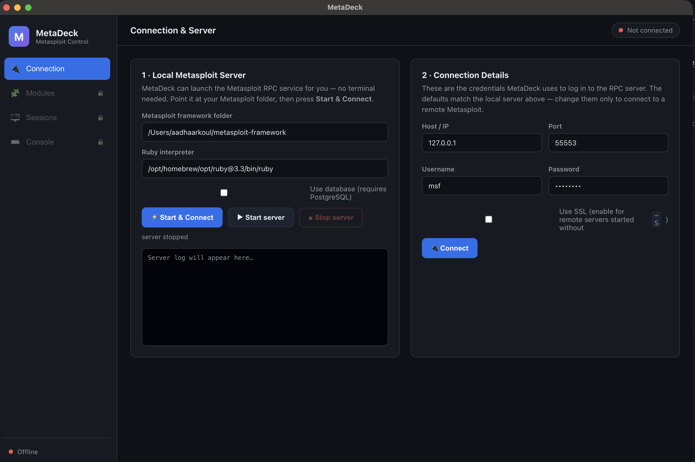

# MetaDeck

**A friendly point-and-click desktop GUI for the [Metasploit Framework](https://github.com/rapid7/metasploit-framework).**

MetaDeck puts a clean, beginner-friendly interface on top of Metasploit so you can
run the whole workflow — connect, search modules, set options, launch, and manage
sessions — with **forms, buttons, and dashboards** instead of the `msfconsole`
terminal. It talks to Metasploit's RPC daemon (`msfrpcd`), the same integration
point used by Armitage and Metasploit Pro.

> ⚠️ **Authorized use only.** Metasploit is a penetration-testing tool. Only use
> MetaDeck against systems you own or have explicit, written permission to test.



## Features (v1)

- **One-click connect** — MetaDeck can launch the local Metasploit RPC server for
  you (no terminal), then log in automatically.
- **Live dashboard** — version info and module counts at a glance.
- **Module browser** — search across exploits, auxiliary, post, payloads, encoders
  and NOPs; filter by type.
- **Smart option forms** — each module's options rendered as labelled boxes, with
  `RHOSTS` / `RPORT` / `LHOST` / `LPORT` highlighted and required fields marked.
- **Payload picker** — for exploits, choose a compatible payload from a dropdown and
  fill its options too.
- **Payload Builder** — generate standalone, transferable payload **files** with
  `msfvenom` (Windows `.exe`/`.dll`, Linux ELF, macOS Mach-O, Android `.apk`,
  PowerShell/Python/Bash scripts, raw shellcode, and more), with optional encoders,
  iterations and bad-character avoidance, saved wherever you choose.
- **Listeners** — start an `exploit/multi/handler` with a custom LHOST/LPORT (with
  one-click local-IP fill) so a payload's call-back becomes a session; see and stop
  running listeners/jobs.
- **Deliver** — host a built file over HTTP on your LAN so an authorized target can
  download it, with copy-able URLs for each interface and a live download log.
- **Category tabs** in the module browser (Windows, Linux, macOS, Android, Web,
  Multi, …) to jump straight to the target type.
- **Sessions dashboard** — live cards for every open session with an interactive
  shell / Meterpreter terminal.
- **Console** — a real `msfconsole` embedded in the app, with quick-command chips
  and command history.

## Architecture

```
React UI (forms, buttons, dashboards)
      │  IPC via contextBridge (preload)
Electron main process
      │  MessagePack-RPC over HTTP
msfrpcd  ──►  Metasploit Framework
```

| Layer | Location |
|---|---|
| RPC client (MessagePack over HTTP) | `src/main/msfrpc.js` |
| Local `msfrpcd` process manager | `src/main/serverManager.js` |
| Main process + IPC handlers | `src/main/index.js` |
| Secure bridge to the UI | `src/preload/index.js` |
| React UI | `src/renderer/` |

## Requirements

- macOS (Apple Silicon or Intel)
- The **Metasploit Framework** checked out locally (e.g. `~/metasploit-framework`)
- **Ruby 3.3** and the framework's gems installed (`bundle install`)

MetaDeck auto-detects common locations for the framework folder and Ruby; you can
override both on the Connection tab.

## Develop

```bash
npm install
npm run dev
```

## Build a .dmg

```bash
npm run dist:dmg
```

The installer is written to `release/`.

## License

BSD-3-Clause (matching the Metasploit Framework).

---
🤖 Built with [Claude Code](https://claude.com/claude-code)
